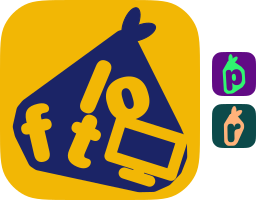

# loft

loft gives your agents a screen of their own on your Mac, so their windows stop crowding yours. It adds a monitor that only exists in software: windows put there stay on, painting and never covered, but you never see them. When you stop loft, the monitor is gone.

## Install
```bash
curl -fsSL https://raw.githubusercontent.com/sryo/loft/main/install.sh | bash
```

## Use
```bash
loft up        # add the hidden monitor (loft up 2560x1440 for another size)
loft status    # whether it's up, its size and where it sits (--json for scripts)
loft down      # remove it
```

An agent that needs a screen of a given size makes its own loft and removes it when done, leaving yours and other agents' alone:
```bash
loft up 1280x800 --new --json   # a new loft that size; prints its id
loft status <id>                # that loft (--json for scripts)
loft list                       # every loft that's up
loft down <id>                  # remove only that one (loft down --all: every one)
```
A loft already up at another size is refused (exit 4) rather than reused at the wrong size.

`--owner <pid>` ties a loft to a process: when that process ends, however it ends, the loft goes too. perch uses it for the lofts it makes itself (`new_tab {url, loft:"1280x800"}`), so an agent never has to clean up.

loft and [rooms](https://github.com/sryo/rooms) speak the same dialect: names are a letter then up to 30 of a-z, 0-9 and -; sizes are `WIDTHxHEIGHT`; `status <name>` exits 3 when it isn't up; with `--json`, an error is `{ok:false, code, error}` on stdout.

For scripts and agents, `loft status --json` prints `{up, id, displayId, vendor, product, name, bounds}` and exits 3 when the loft is down (`loft up --json` prints the same). You can count on the loft's identity staying the same: vendor `0x6c66`, product `0x7466`, and the `displayId` it reports while up. Its name is `"loft"`, though what macOS shows for it is unverified. The records in `~/Library/Application Support/loft` are stable too: `holder.json` for the default loft, `lofts/<id>.json` for each named one. Its bounds are the ones from `up` and don't follow you rearranging displays.

loft never moves your windows. An agent puts its own windows on the loft and takes them back.

## Works with
- [perch](https://github.com/sryo/perch): your agent drives a browser window on the loft, in your own profile, without the slowdowns and refusals a covered or minimized window gets.
- [rooms](https://github.com/sryo/rooms): when the agent needs its own signed-in browser rather than yours.

## Known gaps
- The loft shows up in System Settings > Displays while it's up, and your mouse can wander onto it, since macOS treats it as a real monitor.
- It relies on a part of macOS that Apple doesn't document, so a macOS update could break it.
